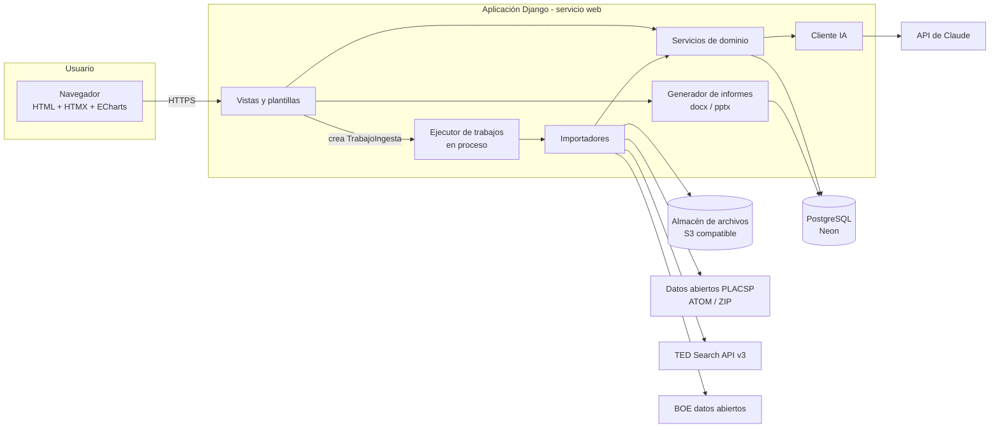

# 02. Arquitectura

## Principios

1. **Monolito modular.** Una sola aplicación Django con apps por dominio. Con menos de 10 usuarios, separar en microservicios solo añade coste y fallos.
2. **Evidencia primero.** Toda afirmación que se muestra procede de una `Evidencia` con fuente. Las métricas se calculan a partir de evidencias, nunca se guardan "a mano".
3. **Importar, normalizar, revisar, publicar.** Ningún dato externo llega al cuadro de mandos sin pasar por normalización y, cuando hay ambigüedad o lo ha propuesto la IA, por revisión humana.
4. **Proveedor sustituible.** Base de datos, almacenamiento de archivos, modelo de IA y alojamiento se configuran por variables de entorno.

## Componentes

## Flujos principales

### A. Actualizar contratación pública (bajo demanda)
1. El analista pulsa "Actualizar contratación" y elige la fuente y el rango de fechas.
2. Se crea un `TrabajoIngesta` en estado `pendiente`. La vista responde en el acto y la página consulta el progreso cada pocos segundos con HTMX.
3. El ejecutor descarga los ficheros por partes, los procesa en streaming, filtra por territorio y hace un upsert por clave natural.
4. La clasificación por servicio (CPV y palabras clave) se hace en el acto. Los casos dudosos van a la bandeja de revisión y la IA se usa solo si está activada.
5. El trabajo termina como `completado` o `con_errores`, con contadores: leídos, nuevos, actualizados, descartados por territorio y errores.

El mismo servicio se invoca con `manage.py ingest_placsp` o `ingest_ted` para ejecutarlo en local si el plan gratuito se queda corto.

### B. Cargar menciones de Brandwatch
Subida del CSV → validar formato → normalizar → deduplicar por `Resource Id` y luego por URL canónica → detectar competidores por alias → marcar la pertinencia territorial → bandeja de revisión para lo dudoso.

### C. Subir recortes PDF y documentos Word
1. El archivo se sube al almacén de objetos (en local, a la carpeta `media/`).
2. Se extrae el texto. Si no hay capa de texto, se envía a la IA para lectura visual (`06`).
3. Del nombre del archivo se intenta sacar medio, edición, fecha y página.
4. La IA propone en formato estructurado las empresas mencionadas, el tema y el municipio; la propuesta queda como borrador.
5. El analista valida y se crean las `Evidencia`.

### D. Generar un informe
El usuario elige el periodo, los competidores y la plantilla. El servicio reúne solo las evidencias validadas y calcula las métricas. La IA redacta los textos a partir de esas evidencias, con referencias a sus identificadores, y se genera el docx o el pptx. Cada cifra incluye su referencia (por ejemplo, `[E-0123]`) y un anexo lista las evidencias usadas.

## Despliegue del piloto (gratuito)

| Pieza | Servicio | Límite conocido | Fuente |
|---|---|---|---|
| Web | Render, instancia Free | 512 MB de RAM y 0,1 CPU; se duerme tras 15 min sin tráfico entrante y tarda en torno a un minuto en despertar | Resumen de precios de Render consultado en noviembre de 2026; verificar en render.com/pricing antes de desplegar |
| Base de datos | Neon, plan Free | 0,5 GB de almacenamiento y 100 CU-horas por proyecto al mes; el cómputo se suspende tras 5 min de inactividad | neon.com/faqs/free-plan-limits-and-quotas |
| Archivos | Pendiente (P-03) | Render Free no ofrece disco persistente para subidas (**por verificar**) | — |
| IA | API de Anthropic | Según contrato de la clave | platform.claude.com/docs |

La base de datos gratuita de Render no se usa: según fuentes de terceros caduca a los 30 días.

## Riesgos de arquitectura y mitigación

| Riesgo | Efecto | Mitigación |
|---|---|---|
| El servicio se duerme a mitad de un trabajo largo | Ingesta incompleta | Trabajos reanudables por partes (cada parte confirma su progreso); la página en primer plano mantiene tráfico; alternativa por comando en local |
| Los ZIP de PLACSP no caben en 512 MB | Error de memoria | Procesar fichero a fichero y con `iterparse`; medir tamaños en la Fase 0 |
| 0,5 GB de base de datos | Se llena | Guardar solo los expedientes del territorio y no guardar el XML completo, solo los campos útiles y la URL de origen; medir en la Fase 0 |
| Cambios de formato en exportaciones o API | Importación rota | Validación de cabecera con mensaje claro y tests con ficheros reales en `tests/fixtures/` |
| Coste de IA inesperado | Factura | Límite de gasto (RNF-09), uso de lotes y modelos pequeños para clasificar |

## Qué revisar al crecer

- Pasar a una instancia de pago sin suspensión y a un trabajador dedicado (worker) para las ingestas.
- Programar la ingesta (diaria o semanal) si se pide.
- Añadir territorios: solo datos de `territorio` y filtros por NUTS o provincia.
- PostGIS, si llegan a hacer falta consultas espaciales (hoy no).
