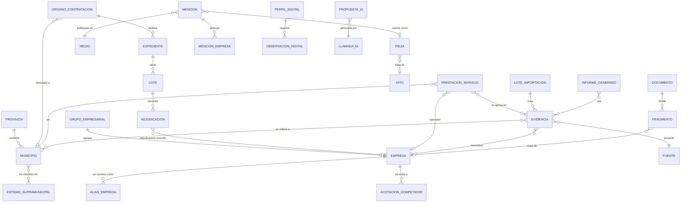

# 03. Modelo de datos

El centro del modelo es la **Evidencia**: un hecho concreto, fechado y con fuente. Las métricas y los textos se calculan a partir de evidencias validadas.

## Diagrama (simplificado)

## Enumeraciones (valores fijos en código)

### NivelEvidencia
Son los niveles del análisis vigente. Su significado no cambia sin actualizar este documento.

| Valor | Etiqueta | Cuándo se usa |
|---|---|---|
| `oficial` | Confirmado (fuente oficial) | Anuncio de adjudicación o formalización en PLACSP, TED o BOE; acta municipal; boletín oficial |
| `prensa` | Confirmado (prensa) | Pieza periodística que afirma el hecho; no hay fuente oficial localizada |
| `empresa` | Confirmado por la empresa | Web, nota de prensa, memoria o informe de la propia empresa |
| `parcial` | Parcial | Hay indicios, pero falta una parte: alcance, vigencia, adjudicatario no leído, título truncado o contrato antiguo sin confirmar la vigencia |
| `no_localizado` | No localizado | No se encontró fuente fiable. No equivale a "no existe" |

Reglas:
- Un nivel `oficial` exige una URL de origen oficial guardada.
- La IA nunca deja una evidencia en `oficial`, `prensa` ni `empresa`: propone, y una persona valida.
- La percepción interna **no** es un nivel de evidencia. Es otro tipo de registro (`PercepcionInterna`) y se muestra siempre separada.

### Servicio y alcance
| Servicio | Alcances (`alcance`) |
|---|---|
| `agua` | abastecimiento, saneamiento, depuración, ciclo integral, otro |
| `residuos` | recogida de RSU, limpieza viaria, ecoparque o punto limpio, tratamiento (a menudo consorcial), transporte o transferencia, otro |
| `energia` | mantenimiento de alumbrado público, gestión energética (ESE), instalaciones térmicas o climatización, mantenimiento eléctrico, renovación o eficiencia (obra), suministro eléctrico (comercializadora), otro |

El suministro eléctrico (comercializadora) se guarda como dato complementario y por defecto **no** cuenta como "servicio energético", según el criterio del análisis vigente.

### Otros
- `EstadoValidacion`: `borrador`, `validada`, `rechazada`.
- `Origen`: `importador`, `ia`, `manual`.
- `TipoFuente`: `contratacion_oficial`, `boletin_oficial`, `acta_municipal`, `prensa_digital`, `prensa_impresa`, `red_social`, `web_corporativa`, `informe_empresa`, `documento_interno`, `otra`.
- `CategoriaEvidencia`: `servicio_municipal`, `contrato`, `mencion_medios`, `evento`, `premio`, `alianza`, `innovacion_financiacion`, `sostenibilidad`, `grupo_interes`, `digital`, `otra`.
- `VinculoTerritorial`: `si`, `no`, `dudoso`.

## Entidades

Campos mínimos. Todos los modelos tienen además `creado`, `modificado` y, si procede, `creado_por`.

### territorio
- **Provincia**: `codigo_ine` (2 dígitos, único), `nombre`, `comunidad`.
- **Municipio**: `codigo_ine` (5 dígitos, único), `nombre_oficial`, `nombres_alternativos` (lista, incluye castellano y valenciano y formas con o sin artículo), `provincia`. Además, `nombres_normalizados` (derivado al guardar, sin tildes ni mayúsculas, con índice GIN) para resolver nombres, y `lote_importacion`. Carga y reglas de nombres en `04` §10.
- **EntidadSupramunicipal**: `nombre`, `tipo` (consorcio, mancomunidad, diputación, otro) y municipios miembros. Hace falta porque el tratamiento de residuos suele ser consorcial.

### entidades
- **GrupoEmpresarial**: `nombre`.
- **Empresa**: `nombre`, `grupo`, `nif` (opcional, único si existe), `es_propia` (excluida del benchmarking), `es_competidor_seguido`, `notas`.
- **AliasEmpresa**: `empresa`, `texto`, `tipo` (marca, razón social, abreviatura, marca local), `requiere_contexto` (para alias ambiguos, como "Cox", que también es un municipio).
- **AcotacionCompetidor**: `empresa`, `servicios_incluidos`, `ambito_geografico`, `nota` (por ejemplo, "STV: solo jardines y zonas verdes de Elche"), `fuente` (documento o decisión de la que sale). `servicios_incluidos` vacío significa que la acotación no limita por servicio; la nota explica el límite (caso de STV, cuyo servicio no está en el catálogo).

### evidencias
- **Fuente**: `tipo`, `nombre`, `dominio` o `url_base`.
- **Evidencia**: `codigo` (legible, `E-000123`, único), `categoria`, `titulo`, `extracto` (máximo unas 300 palabras; no se guardan artículos completos de prensa), `url_origen`, `fecha_publicacion`, `fecha_evento` (opcional; nunca sustituye a la de publicación), `fecha_consulta`, `fuente`, `empresas`, `municipios`, `servicio`, `alcance`, `nivel`, `estado_validacion`, `origen`, `lote_importacion`, `tratamiento_limites` (texto de cautelas, como en el anexo del documento maestro), `datos_extra` (JSON, por ejemplo con quién concede un premio), `validado_por`, `validado_en`.
- **PrestacionServicio** (vista curada que alimenta el mapa): `municipio`, `servicio`, `alcance`, `empresa` (o nulo si es gestión directa o no localizado), `gestion` (indirecta, directa municipal, empresa pública, consorcial, no localizada), `anio_referencia`, `vigencia_confirmada` (sí, no, desconocida), `nivel`, `evidencias`. Restricción de unicidad: (`municipio`, `servicio`, `alcance`, `empresa`).

### contratacion
- **OrganoContratacion**: `id_externo` (identificador en PLACSP), `nombre`, `municipio` (nulo si no está vinculado), `entidad_supramunicipal`, `estado_vinculacion` (`automatica`, `validada`, `pendiente`, `no_aplica`).
- **Expediente**: `fuente` (placsp, ted, boe), `id_externo` (clave natural por fuente; ver `04`), `numero_expediente`, `organo`, `objeto`, `tipo_contrato`, `cpv` (lista), `estado`, `importe_licitacion`, `iva_incluido` (sí, no o desconocido), `fecha_publicacion`, `fecha_actualizacion_fuente`, `url_origen`, `servicio_clasificado`, `metodo_clasificacion` (cpv, palabras clave, ia, manual), `entrada_atom_id` y `fichero_origen` para trazar de dónde salió. Unicidad: (`fuente`, `id_externo`).
- **Lote**: `expediente`, `numero`, `objeto`, `importe`.
- **Adjudicacion**: `lote` (o el expediente si no hay lotes), `adjudicatario_texto` (literal de la fuente), `adjudicatario_nif` (si viene), `empresa` (resuelta por alias o NIF; nula si no se resuelve), `importe_adjudicacion`, `fecha_adjudicacion`, `fecha_formalizacion`, `duracion_texto`.

### medios
- **Medio**: `nombre`, `dominio` (único), `ambito` (local, comarcal, regional, nacional, sectorial, agencia), `grupo_editorial` (opcional).
- **Mencion**: `origen` (brandwatch, clipping, manual), `resource_id` (Brandwatch, único si existe), `url`, `url_canonica`, `fecha_publicacion`, `titulo`, `extracto`, `medio`, `tipo_pagina` (news, twitter, blog…), `idioma`, `sentimiento_fuente` (lo que dice Brandwatch, sin reinterpretar), `region_fuente`, `datos_fuente` (JSON con columnas útiles no modeladas), `vinculo_territorial`, `motivo_vinculo`, `pieza`.
- **MencionEmpresa**: `mencion`, `empresa`, `metodo` (alias, ia, manual), `estado_validacion`, `fragmento_detectado`.
- **Pieza**: la unidad de recuento de prensa (una URL periodística canónica o un recorte). Tiene `codigo` (por ejemplo, P001), `medio`, `fecha_publicacion` y `es_comunicado_propio`.
- **Hito**: acto o noticia de fondo que agrupa varias piezas ("dos medios sobre el mismo acto son dos piezas y un hito").

### documentos
- **Documento**: `tipo` (recorte, valoracion_interna, informe_sostenibilidad, otro), `nombre_archivo`, `sha256` (único), `ruta_almacen` (vacía en modo sin originales), `paginas`, `texto_extraido`, `texto_obtenido_por_ia`, `metadatos` (medio, fecha y página deducidos del nombre del archivo), `subido_por`.
- **Fragmento**: `documento`, `empresa`, `pagina_inicio`, `pagina_fin`, `texto`.
- **PercepcionInterna**: `empresa`, `texto`, `documento_origen`, `contraste` (texto que la relaciona con evidencias), `evidencias_relacionadas`.

### digital
- **PerfilDigital**: `empresa`, `red` (instagram, linkedin, x, facebook, youtube, tiktok, web), `url`, `cuenta_verificada` (sí, no o desconocido).
- **ObservacionDigital**: `perfil`, `fecha_observacion`, `seguidores` (entero o nulo si no es visible), `publicaciones_observadas`, `periodo_observado`, `historico_suficiente` (bool), `notas`. Nunca se guarda 0 cuando el dato no es visible.
- **AuditoriaWeb**: `empresa`, `url`, `fecha`, `tono`, `contenidos_destacados`, `usabilidad` (texto libre con cita de lo observado).

### ia, sistema e informes
- **LlamadaIA**: `tarea`, `modelo`, `version_prompt`, `tokens_entrada`, `tokens_salida`, `coste_estimado`, `estado`, `error`, `usuario`, `objeto_relacionado` (genérico).
- **PropuestaIA**: `llamada`, `tipo_objetivo`, `id_objetivo`, `propuesta` (JSON validado con su esquema), `estado_revision`, `revisado_por`, `comentario`.
- **LoteImportacion**: `tipo`, `parametros`, `archivo_sha256`, `usuario`, `inicio`, `fin`, `leidos`, `nuevos`, `actualizados`, `descartados`, `errores`, `log`. Vive en la app `nucleo` porque la usan todos los importadores.
- **TrabajoIngesta**: ver ADR-007.
- **RegistroAuditoria**: `usuario`, `accion`, `objeto`, `antes`, `despues`, `fecha`.
- **InformeGenerado**: `tipo` (docx, pptx), `parametros`, `archivo`, `evidencias_usadas`, `llamadas_ia`, `generado_por`.

## Reglas de integridad
- Las relaciones `Evidencia`–`Empresa` y `Evidencia`–`Municipio` usan tablas intermedias explícitas con `PROTECT`, para que la restricción de borrado se aplique también a través de la relación muchos a muchos.
- Restricciones de base de datos en `Evidencia`: el nivel `oficial` exige `url_origen`; con `origen = ia`, los niveles `oficial`, `prensa` y `empresa` exigen `validado_por`; el estado `validada` exige `validado_por` y `validado_en`; el alcance debe pertenecer al servicio. `PrestacionServicio` es única también cuando `empresa` es nula (`NULLS NOT DISTINCT`).
- Borrar una empresa con evidencias está prohibido (`PROTECT`); se desactiva.
- Una evidencia validada solo se modifica dejando registro de auditoría.
- Las claves naturales de importación tienen restricción `UNIQUE` en la base de datos, no solo en código.
